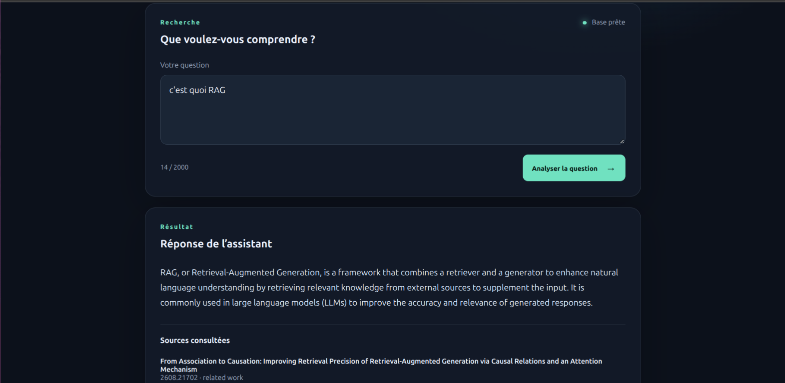

# arxiv-bot

Assistant de recherche basé sur les articles arXiv indexés dans ChromaDB. Le
projet récupère les articles, les découpe en passages, crée leurs embeddings
avec OpenRouter, puis utilise une recherche vectorielle pour répondre aux
questions.

## Aperçu



## Interface web

Après avoir configuré `OPENROUTER_API_KEY` dans l'environnement, dans `.env`,
ou dans le fichier local `api_keys.env`, lancez :

```bash
./env/bin/python app.py
```

Ouvrez ensuite [http://127.0.0.1:8767](http://127.0.0.1:8767). L'interface
affiche la réponse générée et les articles utilisés comme sources.
Le port peut être changé avec `ARXIV_BOT_PORT=8080 ./env/bin/python app.py`.
Si le navigateur affiche `Forbidden` ou `Method Not Allowed`, vous utilisez
probablement un autre serveur sur ce port. Arrêtez-le ou choisissez un port
libre, puis ouvrez exactement l'adresse affichée par `app.py`.
L'interface peut aussi être ouverte depuis le serveur statique de VS Code :
elle enverra alors automatiquement les questions vers `127.0.0.1:8767`.

## Pipeline d'ingestion

L'ingestion existante se lance avec :

```bash
./env/bin/python -m rag.ingestion
```

Les fichiers Parquet sont lus depuis `data/metadata` et l'index est persisté
dans `data/chroma_db`. Si un index existant est présent dans
`data/chroma_db/chroma_db`, il est utilisé automatiquement. Les clés API ne
doivent jamais être ajoutées au dépôt.